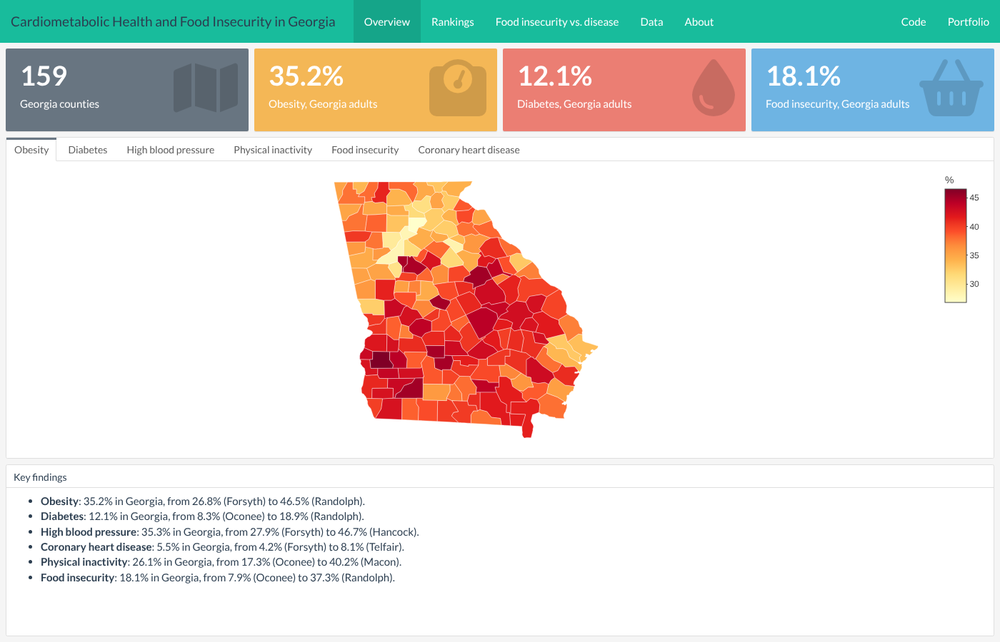

# Cardiometabolic Health and Food Insecurity in Georgia

Interactive dashboard of cardiometabolic conditions (obesity, diabetes, high blood pressure, coronary heart disease), physical inactivity and food insecurity in Georgia's 159 counties, built with R and flexdashboard.

**Live dashboard:** https://mariaalvarez95.github.io/projects/places-georgia/

## Question

Where in Georgia are obesity, diabetes, high blood pressure, coronary heart disease, physical inactivity and food insecurity most common, and do they appear in the same counties?

## Data

- **CDC PLACES: County Data (GIS Friendly Format), 2025 release** ([data.cdc.gov, dataset i46a-9kgh](https://data.cdc.gov/d/i46a-9kgh)). Model-based county estimates for adults 18 and older, built from 2023 Behavioral Risk Factor Surveillance System (BRFSS) data and census population data.
- **County boundaries:** the US counties GeoJSON published by plotly, filtered to Georgia.

Measures (age-adjusted prevalence, %): obesity, diagnosed diabetes, high blood pressure, coronary heart disease, no leisure-time physical activity and food insecurity in the past 12 months.

## Methods

- Age-adjusted prevalence, so counties with different age structures can be compared.
- County estimates are shown with their 95% confidence intervals.
- The Georgia value is the average of the county estimates weighted by each county's adult population (a reference point, not an official state estimate).
- Pearson correlations between food insecurity and obesity or diabetes across counties.

**Limitations:** PLACES estimates are modeled, not direct survey counts, and small counties have wider confidence intervals. County-level (ecological) correlations do not show individual-level relationships or causation.

## Files

| File | What it does |
|---|---|
| `get_data.R` | Downloads the Georgia PLACES data from the CDC API and the county boundaries, and saves them in `data/` |
| `index.Rmd` | The dashboard: data preparation, maps, rankings, scatter plots, table and notes |
| `index.html` | The rendered dashboard |
| `data/` | The data files used by the dashboard |

## How to reproduce

1. Open this folder in RStudio.
2. Install the packages: `install.packages(c("flexdashboard", "dplyr", "tidyr", "readr", "ggplot2", "plotly", "DT", "jsonlite"))`
3. Run `get_data.R` to download the data (optional; the data are already in `data/`).
4. Knit `index.Rmd`.

## Author

Maria Alvarez-Nuncio, MPH · [LinkedIn](https://www.linkedin.com/in/maria-alvarez-nuncio) · [Portfolio](https://mariaalvarez95.github.io/)
