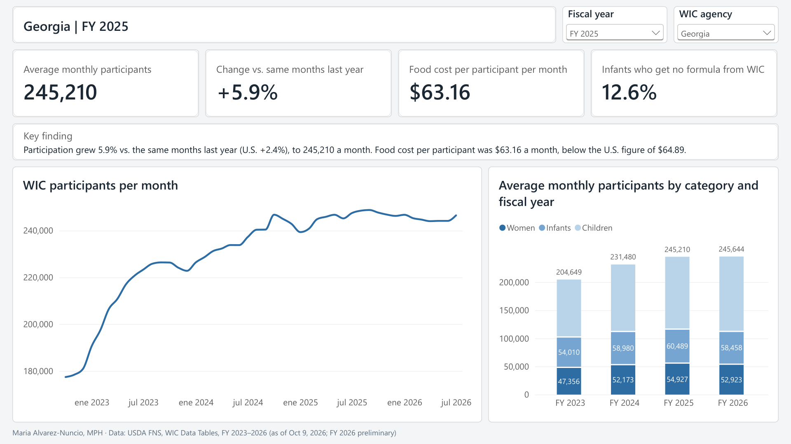

# WIC Participation and Costs: Power BI Dashboard

Power BI dashboard of USDA data for the 89 agencies that run WIC (the Special Supplemental Nutrition Program for Women, Infants, and Children), October 2022 to July 2026. It shows how many women, infants and children WIC serves, what their food costs, and how Georgia compares with the other 50 states and DC.

More pages: [Costs](screenshots/costs.png) · [Georgia vs. states](screenshots/georgia-vs-states.png) · [Overview, FY 2026 so far](screenshots/overview-fy2026.png). The whole dashboard as PDF: [FY 2025](screenshots/WIC_Dashboard_FY2025.pdf) · [FY 2026 so far](screenshots/WIC_Dashboard_FY2026_preliminary.pdf).

## Questions

- How many people does WIC serve each month, and is participation growing?
- How much does WIC spend on food and on nutrition services and administration (NSA), per participant?
- How does Georgia compare with the other states?

## Findings

Fiscal year 2025:

- Georgia served 245,210 participants a month, the sixth-largest state program, up 5.9% from FY 2024 (U.S.: +2.4%).
- Georgia's food cost per participant was $63.16 a month, 18th highest of the 50 states and DC (all WIC agencies: $64.89).
- 12.6% of Georgia WIC infants received no infant formula from WIC, compared with 17.3% nationally.

Fiscal year 2026 so far (October 2025 to July 2026, preliminary):

- Georgia held steady at 245,644 participants a month, +0.5% from the same months of FY 2025, while U.S. participation fell 2.0%.

## Data

- **USDA, WIC Data Tables**, "Monthly Data – State Level Participation by Category and Program Costs", fiscal years 2023 to 2026 ([fna.usda.gov/pd/wic-program](https://www.fna.usda.gov/pd/wic-program)). Data as of October 9, 2026. FY 2026 covers October 2025 to July 2026 and is preliminary.
- `prepare_data.R` turns the four USDA Excel files (one sheet per measure) into three tidy tables and checks that the categories add up to the totals. National totals match USDA's published annual summary.

| Table | Rows | One row per |
|---|---|---|
| `WIC_Monthly` | 4,060 | agency and month: participants by category, food cost, infant formula rebates |
| `WIC_NSA` | 353 | agency and fiscal year: nutrition services and administration costs |
| `Agencies` | 89 | agency: type (state, territory, Indian tribal organization), state, USDA region |

## Model and measures

- Star schema: a DAX `Calendar` table (fiscal year October to September, marked as a date table) and `Agencies` filter both data tables.
- 26 DAX measures, all in `measures.dax`:
  - **Average monthly participants** with `AVERAGEX` over months, because participation is a monthly count (a year is the average of its months, as USDA reports it).
  - **Food cost per participant per month** = food cost ÷ participant-months, USDA's average monthly food cost per person.
  - **Year-over-year change** with `SAMEPERIODLASTYEAR`, so FY 2026 is compared with the same months of FY 2025.
  - **State rank** with `RANKX` and `ALLSELECTED`, and Georgia highlighted through a color measure used in conditional formatting.
  - **Key finding**: a text measure that writes one sentence comparing the selection with the year before and with the U.S.
- Every visual has alt text for screen readers.

## Pages

| Page | What it shows |
|---|---|
| Overview | Average monthly participants, change from the previous year, food cost per participant, share of infants receiving no formula; a one-sentence key finding; monthly trend and participants by category |
| Costs | Food, rebates and NSA costs; cost per participant for the selected agency and the U.S.; year-by-year table |
| Georgia vs. states | Food cost per participant and change in participation for the 50 states and DC, with Georgia highlighted |

## Files

| File | What it is |
|---|---|
| `WIC_Dashboard.pbip` | The dashboard, saved as a Power BI project (open with Power BI Desktop, free) |
| `WIC_Dashboard.SemanticModel/` | The data model as text: tables, Power Query steps, relationships and DAX measures (`definition/tables/_Measures.tmdl`) |
| `WIC_Dashboard.Report/` | The report pages and visuals, one JSON file per visual |
| `screenshots/` | The three pages as PDF files (FY 2025, and FY 2026 so far) and as images (FY 2025, plus the FY 2026 overview) |
| `data/` | The three tidy CSV files the dashboard reads |
| `raw/` | The four USDA Excel files, as downloaded |
| `measures.dax` | Calendar table and all DAX measures |
| `prepare_data.R` | Turns the USDA files in `raw/` into the CSV files in `data/` |
| `wic_theme.json` | Power BI color theme |

**To open it:** download the folder, open `WIC_Dashboard.pbip` in Power BI Desktop and click **Home → Refresh**. The queries read the three CSV files in `data/` from the folder where the project was built; if you saved it somewhere else, point them to your copy in **Transform data → Data source settings → Change source**.

## Limitations

- FY 2026 data are preliminary and cover 10 months.
- USDA records costs when they are paid, so monthly costs jump; costs are compared by fiscal year.
- NSA costs are reported once a year, not by month.
- "Fully breastfed" is a WIC food package category (no infant formula from WIC), not a measured rate of exclusive breastfeeding.

## Author

Maria Alvarez-Nuncio, MPH · [LinkedIn](https://www.linkedin.com/in/maria-alvarez-nuncio) · [Portfolio](https://mariaalvarez95.github.io/)
